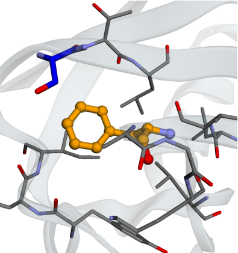
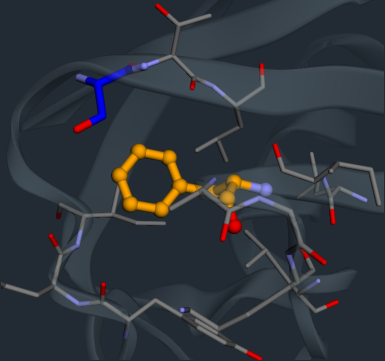

# Protein score playground

Rotate Phe45 in ubiquitin and see how the score changes. Orange marks the
moving side chain; all other atoms stay fixed. Lower scores are favored.

```{raw} html

<section class="tmol-lab" id="score-playground" aria-label="Interactive protein scoring">
  <figure class="lab-poster">
    <picture>
      
      
    </picture>
    <figcaption>Static input geometry of Phe45 in ubiquitin.</figcaption>
  </figure>
  <p class="lab-loading" role="status" hidden>Loading conformations…</p>
  <noscript>Enable JavaScript to change the conformation. The dataset is available below.</noscript>
  <div class="lab-content" hidden>
    <div class="lab-metrics">
      <span>Total score <strong id="lab-total">—</strong></span>
      <span><strong id="lab-change">—</strong> from start</span>
    </div>
    <div class="lab-grid">
      <div class="lab-scene">
        <div id="protein-viewer" hidden role="img" aria-label="Ubiquitin with movable Phe45 in orange and the selected interaction partner in blue"></div>
        <div class="lab-view-controls" role="group" aria-label="Structure view">
          <button type="button" id="lab-focus" aria-pressed="true">Side chain</button>
          <button type="button" id="lab-whole" aria-pressed="false">Whole protein</button>
        </div>
        <p id="viewer-status">Drag to rotate. Scroll or pinch to zoom.</p>
      </div>
      <div class="lab-controls">
        <label for="lab-chi1">χ1 rotation <output id="lab-chi1-value" for="lab-chi1">0°</output></label>
        <input id="lab-chi1" type="range" min="0" max="23" step="1" value="12">
        <label for="lab-chi2">χ2 rotation <output id="lab-chi2-value" for="lab-chi2">0°</output></label>
        <input id="lab-chi2" type="range" min="0" max="23" step="1" value="12">
        <div class="lab-actions">
          <button type="button" id="lab-reset">Reset</button>
          <button type="button" id="lab-optimum">Best sampled</button>
        </div>
        <p id="lab-feedback" class="visually-hidden" role="status" aria-live="polite"></p>
        <details class="lab-landscape">
          <summary>Score landscape</summary>
          <p>Drag to set both rotations. Darker cells have lower scores.</p>
          <canvas id="lab-map" width="288" height="288" role="img" aria-label="Score landscape: chi1 increases left to right; chi2 increases bottom to top. Use the labeled sliders for keyboard control."></canvas>
          <p class="lab-map-key">χ1: −180° → +165° · χ2: −180° ↑ +165°</p>
        </details>
        <div class="lab-score-table">
          <table><caption>Score terms</caption><thead><tr><th scope="col">Term</th><th scope="col">Score</th><th scope="col">Change</th></tr></thead><tbody id="lab-terms"></tbody></table>
        </div>
      </div>
    </div>
    <div class="lab-partners">
      <h2>Residue interactions</h2>
      <p>Phe45–partner scores and changes from the start. Select a residue to show it in blue.</p>
      <div id="lab-partners" role="group" aria-label="Residue interaction partners"></div>
      <p id="lab-partner-detail" class="visually-hidden" aria-live="polite"></p>
    </div>
  </div>
</section>
```

## Data and method

The sliders select **576 conformations**, scored with `beta2016_score_function`
at 15° intervals relative to the input geometry. TMol scores all atoms,
including hydrogens; the viewer shows heavy atoms. The browser reads these
recorded values without interpolation. **Best sampled** selects the lowest
score on this grid.

The term table reports weighted whole-protein scores. Residue interactions
exclude Phe45's self terms and show the eight partners with the largest changes
between the starting and best sampled states. All changes are relative to the
starting conformation.

[Download the dataset](_static/playground/phenylalanine.json), including input
hashes, code revision, and scoring settings. To regenerate it from the bundled
[1UBQ](https://www.rcsb.org/structure/1UBQ) structure:

```bash
python scripts/generate_score_playground.py
```

For a full side-chain search, see {ref}`repacking <glossary-repacking>`.
The {doc}`quickstart` shows how to score, repack, and relax your own structures.
